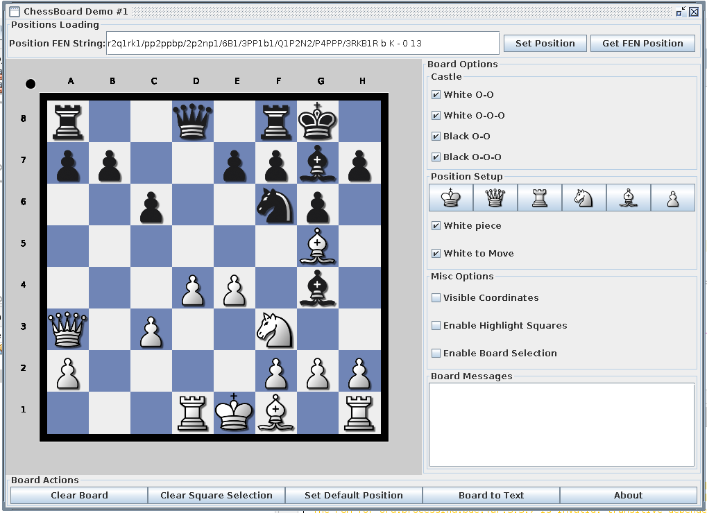

# Processing 3 Chessboard

Desktop chessboard and position editor built with Java, Swing, and Processing 3.



## Requirements

- JDK 17 or newer
- Maven 3.9 or newer

## Build and test

```shell
mvn clean verify
```

## Run

```shell
mvn exec:java
```

## Features

- Load and export complete six-field FEN positions.
- Validate piece placement, active color, castling rights, en-passant target,
  halfmove clock, and fullmove number.
- Select squares and place white or black pieces.
- Move a piece by selecting its origin and destination; occupied destinations
  request confirmation before exchanging both pieces.
- Clear selections or reset the board to the initial chess position.
- Toggle coordinate labels and selected-square highlighting.
- Open UTF-8 PGN files containing one or many games and choose a game from a
  sortable metadata table.
- Replay the main line or click annotated variations, with manual
  start/previous/next/end controls synchronized to the board.
- Inspect annotated notation and an active-line scoresheet beside the existing
  editor. The editor is read-only during playback and its prior position is
  restored when the game is closed.

## PGN playback

Choose **File → Open PGN…**, select a game, and use the transport controls
below the board. Click any move in **Notation** to enter that variation, or a
cell in **Scoresheet** to jump within the active line. Choose
**File → Close game** to return to the exact editor position that was visible
before playback.

The player supports standard chess, comments, NAGs, nested RAV variations, and
`SetUp`/`FEN` starting positions. Chess960 and other variants are intentionally
rejected in this version.

The module intentionally remains on `org.processing:core:3.3.7`, the newest
Processing 3 core artifact available from Maven Central.

PGN parsing and legal move application use chesslib 1.3.7 from JitPack.
